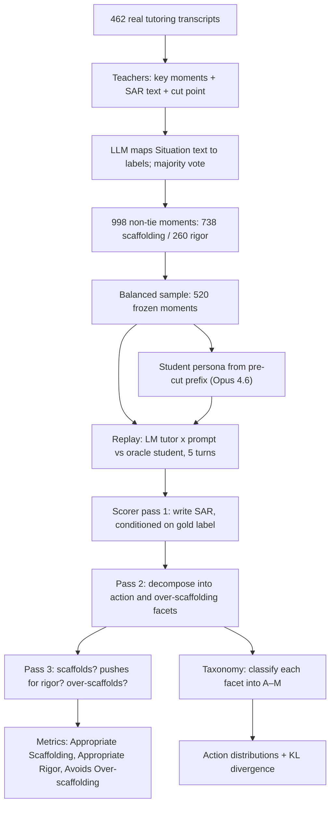

# TutorMoments — Paper Summary (Phase 1)

EURECOM semester project · Stefano Longo, Daniele Priola · prepared 20 Oct 2026

**How to read the source tags in this document**

| Tag | Meaning |
|---|---|
| **[Paper §x / p.y]** | Stated explicitly in the PDF |
| **[Code: file]** | Found in the GitHub repository (commit `c6e26d7`, 19 Oct 2026) |
| **[HF card]** | Stated on the Hugging Face dataset card |
| **[Website]** | Stated on tutormoments.allen.ai |
| **[Our slides]** | Your own dataset analysis (`socrate.pdf`), not yet re-verified by me |
| **[Interpretation]** | My own reading, reconstruction or hypothesis — not a fact from the sources |

Nothing in this document comes from running the benchmark. No experiment has been executed yet.

---

## 0. Source verification

| Source | Accessed? | What I checked | Version recorded |
|---|---|---|---|
| Paper PDF (`tutormoments-preview.pdf`, project file) | Yes, all 50 pages | Full text incl. appendices A–E | PDF created 6 Aug 2026 (pdfTeX metadata) |
| Website tutormoments.allen.ai | Yes | Leaderboard text, method description, authors, links | Live page, 20 Oct 2026 |
| GitHub allenai/tutormoments | Yes, cloned | README, config, model registry, build code, analysis folder | `main` @ `c6e26d7` (2026-10-19) |
| HF dataset allenai/tutormoments-preview | Card only (via web reader) | Configs, row counts, license, notes | Revision SHA **not yet recorded** — HF Hub is blocked from my sandbox shell; to be pinned in Phase 3 on your machine |

All four sources point to each other (website → paper, code, dataset; README → dataset id `allenai/tutormoments-preview`; dataset card → paper title). They are the same project.

**Title and status.**
- PDF title: *"When Help is Unhelpful: Evaluating AI Tutors for Productive Struggle"*. The website uses *"TutorMoments‑Preview: When Help is Unhelpful — Evaluating AI Tutors for Productive Struggle"*.
- Authors: Zhang, Ross, Patel, Bernado, Bowie, Trindade Ribeiro, Halper, Valayaputtur, Andreas, Loeb, Lucy (Li), Lo, Knight — Ai2, Insource Services, UW, MIT, Stanford, Step Up Labs.
- **Status: preliminary working paper, not peer-reviewed.** The paper calls itself "this preliminary report" and "working paper" [Paper §1, p.2]; the website refers to "the July working paper" [Website]; the repo freezes it as `analysis/working-paper-20260630` [Code]; the dataset card says the paper is still in preparation and the citation will be updated on publication [HF card]. No conference or journal venue is given anywhere. Cite it as a working paper / preprint.

---

## 1. Executive summary

**What TutorMoments is.** A benchmark (and a released dataset) that tests whether a language model acting as a math tutor *chooses the right kind of help at the right moment* — not just whether it is "helpful".

**The problem.** Chat models are trained to be helpful assistants. In tutoring, maximal helpfulness can hurt learning: if the tutor does the thinking, the student doesn't. Good teaching balances **scaffolding** (making the problem accessible: hints, smaller steps, guiding questions) against **pushing for rigor** (making the student think harder: "explain why", "try it on your own", a harder problem). Learning theory calls the useful effort in between **productive struggle**. Existing tutoring benchmarks mostly reward one behaviour everywhere ("never give the answer", "always scaffold") without asking whether it fits the situation [Paper §1].

**Why it matters.** Prior studies show that unguided AI help can raise performance during practice but lower performance afterwards (Bastani et al., 2025, cited in [Paper §1]). If AI tutors default to over-helping, they may undermine learning at scale.

**What the authors investigate.** Whether LMs adapt their tutoring move to the situation: scaffold when the student needs support, push for rigor when the student is ready, and avoid over-scaffolding — and how much this depends on the model and on the prompt.

**How it works (in five steps).**
1. Real one-to-one online math tutoring sessions (462 transcripts, grades 2–7, U.S.) [Paper §3.1].
2. Experienced math teachers mark **key moments** where the tutor faced (or should have faced) a scaffold-vs-rigor decision, write a free-text **Situation / Action / Result (SAR)** description, and pick a **cut point** [Paper §3.3].
3. An LLM turns each teacher's Situation text into labels; a majority vote across teachers decides whether the moment is **scaffolding-appropriate** or **rigor-appropriate**. 260 + 260 = **520 moments** are selected [Paper §3.4].
4. **Replay**: the LM tutor gets the real transcript up to the cut point and continues it for 5 turns (3 tutor, 2 student) against a simulated **oracle student** (Claude Opus 4.6, given a persona of the real student and the full original transcript) [Paper §2.2].
5. **Scoring**: another LLM writes an SAR description of the replay, breaks it into atomic "facets", and classifies: did the tutor scaffold? push for rigor? over-scaffold? These give three metrics — **Appropriate Scaffolding**, **Appropriate Rigor**, **Avoids Over-scaffolding** — plus a 13-category **action taxonomy** and a **KL divergence** measuring how differently the tutor acts in the two situation types [Paper §4].

**Models evaluated.** Claude Opus 4.8, Claude Sonnet 4.6, DeepSeek V4 Pro, Gemini 2.5 Pro, Gemini 3.5 Flash, GPT-5.5, GPT-5.4 mini — each with a **plain** prompt ("tutor well") and an **evaluation-aware** prompt (explains the scaffolding/rigor/over-scaffolding trade-off) [Paper §5, Table 8, Table 14].

**Main findings** [Paper §5].
- With the plain prompt, models over-scaffold and rarely push for rigor: Appropriate Rigor ranges from 0.023 (GPT-5.4 mini) to 0.223 (Gemini 2.5 Pro).
- The evaluation-aware prompt improves every score for every model, but big gaps remain (Appropriate Rigor 0.404 → 0.831).
- Human tutors on the same moments score 0.458 / 0.182 / 0.496 — roughly plain-prompt level — but they are a *reference, not a ceiling*, because teachers deliberately flagged moments where tutoring could have gone better.
- Plain-prompted models explain and ask funnelling questions more than humans; evaluation-aware models instead prompt for justification 2.8–5.1× more than humans, i.e. their rigor behaviour collapses onto one move.
- Better-scoring models are also the slowest (>10 s per turn for Opus 4.8 and Gemini 2.5 Pro).

**Main limitations** [Paper §7 + Interpretation].
- Measures decisions at teacher-chosen moments, not overall tutoring quality and not actual student learning.
- Several LLM layers sit between the teachers and the final score (situation labels, student persona, simulated student, SAR generation, facet decomposition, classification). The scorer itself detects rigor poorly (recall ≈ 0.53–0.55, Table 5).
- Teacher agreement on the situation label is moderate (68% / 63% full agreement).
- One tutoring provider, U.S., math, mostly English; the 520 moments come from only 112 sessions [Our slides], so moments are not independent.
- Simulated students behave "unnaturally successfully" [Paper §2.2].

**Why it is useful.** It turns a pedagogical idea (help vs challenge, depending on context) into a repeatable, model-agnostic measurement on *the same* real situations, and releases transcripts, annotations, replays and judgments so others can recompute or extend it.

---

## 2. Section-by-section explanation

### Abstract
- **Says:** benchmarks check *behaviours* (e.g. "doesn't give answers") but not whether they are *appropriate*. TutorMoments replays teacher-identified decision points and scores scaffolding, rigor and over-scaffolding.
- **Main message:** default LMs over-help; prompting helps but doesn't close the gap; models use a narrow set of moves.
- **Why it matters:** it states the three headline claims you will need to defend.

### §1 Introduction
- **Says:** helpful-assistant training may conflict with learning. Educational theory (zone of proximal development, scaffolding, productive struggle, desirable difficulty) frames teaching as balancing support and challenge — the **assistance dilemma** (Koedinger & Aleven, 2007). MathTutorBench and MRBench reward "don't give the answer"; LearnLM's rubric is underspecified.
- **Concept introduced:** *situation-conditioned* evaluation — judge the action relative to what the moment needs.
- **Evidence:** literature only.
- **Why it matters:** this is the paper's positioning; a professor will ask "what's new vs MathTutorBench?" The answer is: conditioning on the situation, and multi-turn replays on real transcripts.

### §2 Framework
**§2.1 Task conditions.** Defines scaffolding (temporary support that makes content accessible), over-scaffolding (reducing cognitive demand more than necessary), and pushing for rigor (raising cognitive demand when the student is ready). Moments are labelled by teachers as scaffolding- or rigor-appropriate; this lets the benchmark also count *missed opportunities*.

**§2.2 Simulated replays.** The real transcript is cut; the LM tutor continues. Same history for every model → a controlled comparison. Two prompts: plain and evaluation-aware (full text in Appendix D.2 and `src/tutormoments/prompts/tutor/`). The student is Claude Opus 4.6 conditioned on a persona extracted from the pre-cut transcript along five traits (active/passive, affect, focus, readiness to revise beliefs, misconceptions) and **allowed to see the full original transcript** — hence "oracle student". 5 turns, tutor starts. Scoring only looks at the generated replay, not the human transcript.
- **Admitted weakness:** even oracle students are "unnaturally successful", so the student is a placeholder; scoring focuses on tutor moves, not student outcomes.

### §3 Data curation and annotation
- **§3.1 Sourcing:** high-dosage tutoring provider; volunteer/work-study tutors without AI; mostly Title 1 schools. 462 text-only transcripts, 198 students, 173 tutors, grades 2–7, ~54 min and ~384 turns per session. Audio transcribed — and whiteboard actions described ("enrichments") — by Gemini 2.5 Pro. Note: the transcripts themselves are already LLM-produced [Interpretation: one more source of noise].
- **§3.2 De-identification:** LLM-based, adapted from NTO's math-aware prompt; on 50 held-out transcripts recall 0.997 / precision 1.00 for direct identifiers and recall 0.932 for quasi-identifiers (details Appendix A).
- **§3.3 Teacher annotation:** 27 active U.S. teachers (>3 years experience; 14 report >10 years in §3.3, 13 in Appendix B — small internal inconsistency), paid $35–45/h. They mark key moments, write SAR text (avg. 82 words), choose a cut point (always a student turn). One teacher selects the span; others re-annotate it → 3.5 annotations per moment. Totals: 122 annotated transcripts, 1,536 unique key moments (Table 1). Footnote 1: when teachers disagree on the cut point, the most common one is used, ties → earliest.
- **§3.4 Situation types:** Claude Opus 4.8 maps each Situation text to `{scaffolding, rigor} ∈ {yes, no, unclear, no_mention}`; validated at 96% accuracy on 200 samples vs one author. Full agreement among teachers: 68% (scaffolding), 63% (rigor). Majority vote, ties excluded → **738 scaffolding, 260 rigor**; 260 scaffolding sampled at random → balanced 520.
- **Why it matters:** this is where the "ground truth" comes from — and it is itself a combination of human text, an LLM mapping and a vote.

### §4 Scoring replay outcomes
- **§4.1 Pipeline:** (1) an LM writes SAR for the replay, **conditioned on the gold situation label** (privileged information); (2) *decompose* SAR into atomic facets — one prompt for action direction, one for over-scaffolding; (3) *structure* facets into binaries: scaffolds? pushes for rigor? Over-scaffolding = "the over-scaffolding decomposer returned a non-empty list". Facet faithfulness: 164 facets on 30 moments all matched real actions. Over-scaffold decomposer: 94.5% accuracy, 88.9% F1 on 200 teacher annotations.
- **§4.2 Validation:** 207 annotated transcripts split 102 / 105 (iteration / held-out). They run the same decompose+structure on teachers' SAR and on LM-generated SAR of the *human* replay and compare binaries.
  - Table 5 (action direction, held-out): scaffolding F1 0.90–0.95; **rigor F1 0.56–0.64, recall 0.43–0.55**.
  - Table 6 (over-scaffolding, held-out): vs "≥1 teacher mentioned it" F1 0.49–0.70; vs "≥2 teachers" precision drops to 0.34–0.39 but recall rises (0.46–0.82).
  - Prompts were tuned on Claude Opus 4.6 and generalise only partly to other model families; self-preference bias is flagged.
- **§4.3 Action taxonomy:** 13 categories (Table 7) built iteratively with Claude Opus 4.8 + manual refinement: 6 scaffolding (guiding questions, breaking into steps, explaining/co-solving, alternative representations, hints, supplying answers), 4 rigor (prompting for explanation, withdrawing support, increasing complexity, prompting self-assessment), 2 neutral (affirmations/check-ins, transitioning), 1 Other. Each facet classified independently of the gold label. A rule-based filter removes negated actions ("the tutor fails to…") and bare stance phrases ("the tutor scaffolds"). 1,967 human and 6,589 LM facets classified.
- **§4.4 Metrics:** formal definitions of S, R, O and KL divergence (see Phase 2 / `metrics_catalog.md` to come). Key design choices: rigor in a scaffolding moment is *not* penalised (and vice versa); over-scaffolding is *always* penalised.

### §5 Results
Covered in detail in Section 5 below.

### §6 Conclusion
Rigor moves are harder for LMs both to *recognise* (scorer recall) and to *produce* (tutor scores). Prompt and model choice strongly shift behaviour. The paper is a preview of a larger multimodal release with an improved annotation and scoring pipeline.

### §7 Limitations
No measurement of real learning; LLM judges and the oracle student need further work; single provider/context, U.S., math.

### Appendices
- **A** De-identification details (PII taxonomy extended with ORGANIZATION, USERNAME, PASSWORD, PET NAME…).
- **B** Annotator backgrounds (29 recruited, 27 active).
- **C** Annotation instructions, v1 and the revised v2 (adds moment-boundary guidance and the cut point).
- **D** Prompts (abbreviated; full prompts in the repo) and **D.4 model configuration** (Table 14).
- **E** Student-outcome scorer: attempted, reasonable alignment (0.77–0.82), but **not used** because synthetic students lack face validity.

---

## 3. Research questions and contributions

The paper does not number research questions. The following are **my reconstruction [Interpretation]**, each anchored to the section that answers it.

| # | Research question (reconstructed) | Answered in | Answer in the paper |
|---|---|---|---|
| RQ1 | Can teachers' free-text judgments be turned into a reliable, scalable LM-based scoring pipeline for scaffolding, rigor and over-scaffolding? | §4.2, Tables 5–6 | Yes for scaffolding; partially for rigor and over-scaffolding |
| RQ2 | With minimal prompting, do LM tutors scaffold and push for rigor appropriately? | §5, Table 8 | No — they over-scaffold and rarely push for rigor |
| RQ3 | Does an evaluation-aware prompt improve situational appropriateness? | §5, Table 8 | Yes, for all models, but unevenly |
| RQ4 | Does the benchmark discriminate between models? | §5 | Yes — recovers Opus > Sonnet, GPT-5.5 > GPT-5.4 mini, and separates frontier models |
| RQ5 | Which tutoring moves do LMs use compared with humans, and do they adapt them to the situation? | §5, Figs 4–6, Table 9 | Plain: tutor-directed scaffolding, low adaptation; eval-aware: more adaptation, rigor concentrated on "prompting for justification" |
| RQ6 | Is there a quality–latency trade-off? | §5, Fig 7 | Best models are slowest |

**Implicit hypothesis** [Interpretation]: helpfulness-oriented post-training biases LMs toward over-scaffolding. Note the paper tests the *symptom* (behaviour), not the *cause* (training) — that causal claim is not established.

**Scientific contributions** [Paper §1, §6]:
1. A situation-conditioned, replay-based evaluation framework.
2. A teacher-annotated dataset (SAR + cut points) on real tutoring transcripts — TutorMoments-Preview.
3. A validated LM scoring pipeline (SAR generation → facet decomposition → binary structuring).
4. A 13-category scaffolding/rigor action taxonomy and an action-divergence (KL) metric.
5. Results for 7 frontier/open models × 2 prompts, with all replays released.

**Experimental design.**

| Element | Value |
|---|---|
| Independent variables | Tutor model (7); prompt mode (plain vs evaluation-aware) |
| Condition / stratifier | Situation type (scaffolding vs rigor), from teacher majority vote |
| Held constant | Pre-cut transcript, student model + persona, replay length (5 turns), scorer model and prompts |
| Dependent variables | S, R, O per (model, prompt) cell; action category distribution; KL(S‖R), KL(R‖S); latency |
| Baselines / references | Human tutors on the same moments (naturalistic reference, explicitly not a ceiling); plain prompt as a within-model baseline |
| Unit of analysis | Moment (one replay per moment per cell; `trials: 1` by default [Code: default_config.yaml]) |

---

## 4. Methodology, end to end

### 4.1 Numbered workflow

1. **Transcripts** — 462 real sessions, de-identified, normalised (audio → text and whiteboard → "enrichments" by Gemini 2.5 Pro).
2. **Teacher annotation** — key-moment spans, SAR text, cut point; ~3.5 teachers per moment.
3. **Ground-truth labelling** — LLM maps Situation → scaffolding/rigor labels per annotation; majority vote per moment; ties dropped (738 S / 260 R). The same build step also labels action direction, student outcome and over-scaffolding facets of the *human* tutor [Our slides: `ground_truth` fields `*_agg`, `overscaffold_decomposed`].
4. **Moment selection** — 260 S sampled + all 260 R = 520, frozen as `moments` with context up to the cut, gold label, human continuation, persona and provenance.
5. **Persona extraction** — Claude Opus 4.6 summarises the student's traits from the pre-cut prefix only; frozen in the dataset.
6. **Replay** — tutor (model × prompt) and oracle student alternate for 5 turns starting with the tutor.
7. **Scoring pass 1 – annotate** — scorer writes SAR of the replay, given the gold situation.
8. **Scoring pass 2 – decompose** — action facets; over-scaffolding facets.
9. **Scoring pass 3 – structure** — binary: scaffolds, rigor, over-scaffold.
10. **Metrics** — S over scaffolding moments, R over rigor moments, O over all.
11. **Taxonomy** — each action facet → category A–M; distributions per situation; KL in both directions.
12. **Reporting** — leaderboard, figures, latency/cost.

### 4.2 Diagram

### 4.3 What is described, implemented, released, reproducible

| Step | Described in paper | Implemented in repo | In released dataset | Reproducible by us |
|---|---|---|---|---|
| Transcription + enrichments | Yes | No (provider-side) | Output only (`transcripts`) | No — not needed |
| De-identification | Yes (App. A, D.3) | Not found in repo so far | Output only | No — not needed |
| Teacher annotation | Yes | No (human task) | `annotations` | No |
| Situation labelling + vote | Yes (§3.4) | `tutormoments_build/groundtruth.py` (maintainer extra) | `ground_truth` | Yes, with Anthropic API (costly) |
| Selection of the 520 | Briefly ("randomly select") | Frozen id list `balanced_520_ids.json`; **sampler not in repo** ("not derivable") [Code: README] | `moments` | Only by using the frozen list |
| Personas | Yes (§2.2) | `tutormoments_build/traits.py` | Frozen in `moments` | Use frozen ones (regenerating changes the student population) |
| Replay | Yes | `src/tutormoments/conversation.py`, `tutor.py`, `student.py` | `benchmark_520` (7,280 replays) | Yes — needs paid APIs |
| Scoring (3 passes) | Yes | `src/tutormoments/scoring.py` + `prompts/scorer/` | `annotation` column of `benchmark_520` | Yes — needs Anthropic API |
| Metrics S, R, O | Yes (§4.4) | `scoring.py`, `results.py`, `report.py` | Recomputable from `benchmark_520` | **Yes, offline, free** |
| Taxonomy + KL | Yes | `src/tutormoments/taxonomy.py` | `action_taxonomy` (regenerated Oct 2026) | Partly — paper's exact KL/figure inputs no longer exist |

(Exact functions per step will be confirmed in Phase 4.)

---

## 5. Results

### 5.1 Main table (Table 8)

| Tutor | Plain S | Plain R | Plain O | Eval-aware S | Eval-aware R | Eval-aware O |
|---|---|---|---|---|---|---|
| Claude Opus 4.8 | 0.615 | 0.208 | 0.462 | 0.858 | 0.831 | 0.896 |
| Claude Sonnet 4.6 | 0.573 | 0.085 | 0.437 | 0.831 | 0.792 | 0.913 |
| DeepSeek V4 Pro | 0.485 | 0.088 | 0.379 | 0.712 | 0.492 | 0.623 |
| Gemini 2.5 Pro | 0.727 | 0.223 | 0.546 | 0.896 | 0.712 | 0.854 |
| Gemini 3.5 Flash | 0.723 | 0.158 | 0.598 | 0.885 | 0.646 | 0.817 |
| GPT 5.5 | 0.269 | 0.046 | 0.173 | 0.773 | 0.531 | 0.665 |
| GPT 5.4 mini | 0.181 | 0.023 | 0.188 | 0.738 | 0.404 | 0.598 |
| *Human tutors (reference)* | *0.458* | *0.182* | *0.496* | — | — | — |

S = share of scaffolding moments where the tutor scaffolded **and** did not over-scaffold. R = share of rigor moments where the tutor pushed for rigor **and** did not over-scaffold. O = share of all moments without over-scaffolding. All are proportions in [0, 1], higher is better.

**How to read it.**
- *Plain → evaluation-aware improves every cell.* Justified conclusion: the prompt strongly changes measured behaviour. Alternative reading [Interpretation]: the evaluation-aware prompt uses the same vocabulary as the scorer ("scaffold", "push for rigor", "over-scaffold"); part of the gain could be the tutor *describing* its moves in words the scorer recognises, not only better teaching. Testable in later phases.
- *Plain R is very low (0.02–0.22).* Justified: by this scorer, models rarely push for rigor. Caveat: the scorer's rigor recall is only ≈0.55 on human data (Table 5), so R may be **underestimated** in absolute terms for everyone — comparisons between models are safer than absolute values [Interpretation].
- *GPT-5.5 plain O = 0.173.* GPT models over-scaffold in >80% of moments by this pipeline. Note S and R both require "no over-scaffolding", so a low O drags S and R down mechanically.
- *Human reference ≈ plain prompt level.* Not a ceiling: moments were selected because something could have gone better [Paper §5].
- *Model ordering.* Claimed to recover known capability orderings. Table 8 uses all 520 moments (260 per situation; verified by our recomputation, see 7.1). With one run per moment, a 95% binomial interval on a proportion near 0.5 with n = 260 is about ±0.06, and wider once you account for moments clustered in 112 sessions [Interpretation, my calculation]. Small differences (e.g. Opus 4.8 vs Sonnet 4.6 eval-aware S: 0.858 vs 0.831) may not be distinguishable — to check with the session-bootstrap intervals in `table8_recomputed.csv`. The paper reports no confidence intervals or significance tests; the website now shows intervals.

### 5.2 Validation of the scorer (Tables 5, 6)
- Scaffolding detection is strong (F1 ≈ 0.93 for Opus 4.8 held-out).
- Rigor detection is weak (F1 0.64, recall 0.55 for Opus 4.8).
- Over-scaffolding: F1 0.70 vs "≥1 teacher"; precision 0.36 vs "≥2 teachers" (the pipeline flags far more moments than two teachers agree on).
- Justified conclusion: the pipeline is reliable for scaffolding, noisier for rigor and over-scaffolding. Unaddressed: these numbers are measured on *human* transcripts; their transfer to *LM* replays (different style, more verbose) is assumed, not shown [Interpretation].

### 5.3 Action taxonomy (Figures 4–6)
- Plain: explaining 13–34% of actions (humans 17.7%), guiding questions 16–23% (humans 10.2%) → tutor does more of the cognitive work.
- Eval-aware: explaining drops to 2.7–15%; prompting for justification is 2.8–5.1× the human rate.
- In rigor moments, eval-aware models adapt almost entirely through "prompting for justification" — little use of withdrawing support, increasing complexity or self-assessment.
- Caveat: these figures are computed on the paper's ~100-moment cells and from a classification run that, per the repo, no longer exists (see 7.3).

### 5.4 Action divergence (Table 9)
- Humans 0.179 / 0.177; plain models 0.048–0.182; eval-aware 0.119–0.345. Sonnet 4.6 eval-aware shows the largest separation; GPT-5.5 plain the smallest.
- Interpretation in the paper: high S/R scores could be reached by doing similar things everywhere; KL checks real adaptation. Opus 4.8's KL barely changes between prompts even though its scores jump.
- **Strong caveat**: KL values depend on sample size via add-one smoothing; the repo and website both say the paper's KL numbers are not comparable to recomputed ones (human reference on the full 520: 0.524 / 0.591) [Code: README; Website].

### 5.5 Latency (Figure 7)
- Best eval-aware performers (Opus 4.8, Gemini 2.5 Pro) average >10 s per tutor turn. Correlation, not causation: the faster models are also smaller/cheaper ones.

---

## 6. Terminology

| Term | Simple definition | Technical meaning in this paper | Example |
|---|---|---|---|
| Socratic tutoring | Teaching by asking questions so the student works things out | Not a formal construct in the paper; the closest are rigor moves like "prompting for justification" | "How do you know 3/4 is bigger than 2/3?" |
| AI tutor / LM tutor | A chatbot acting as a tutor | The model under test, continuing a cut transcript under a tutor prompt | GPT-5.5 with the plain prompt |
| Scaffolding | Temporary help that makes a task doable | Moves A–F of Table 7 | "Let's first find a common denominator. What's the LCM of 4 and 3?" |
| Rigor / push for rigor | Asking the student to think harder | Moves G–J: explain, withdraw support, harder task, self-assess | "You got 12. Can you check it another way?" |
| Productive struggle | Effort that is hard but still leads somewhere | Theoretical goal; not measured directly | Letting the student try a second strategy before hinting |
| Over-scaffolding | Helping more than needed | Non-empty output of the over-scaffolding decomposer | Student says "I've got this", tutor walks through every step |
| Zone of proximal development | What a student can do with some help but not alone | Used in the evaluation-aware prompt | — |
| Key moment | A span where the scaffold-vs-rigor choice matters | Teacher-selected span + cut point | Turns 140–162 of a session on fractions |
| Cut point | Where the replay starts | A student turn chosen by teachers (mode of votes, ties → earliest) | After "I think it's 5/7?" |
| SAR annotation | Teacher's Situation / Action / Result description | Free text, ~82 words; source of all labels | See Table 2 of the paper |
| Facet | One small atomic statement | Output of the decompose step | "The tutor asks the student to explain why the answer is correct." |
| Ground truth | The "correct" label for a moment | Majority vote of LLM-mapped teacher situation labels | Moment labelled `rigor` |
| Human annotation | Labels/text written by people | Teacher SAR + cut point | — |
| LLM-generated annotation | Labels/text written by a model | Situation labels, persona, scorer SAR, facets, categories | — |
| LLM-as-a-judge | A model grades another model's output | The 3-pass scorer (Claude Opus 4.6 per Table 14 / config) | — |
| Simulated (oracle) student | An LLM pretending to be the student | Opus 4.6 with persona + full original transcript | Repeats the real student's misconception |
| Replay | Re-running a moment with a new tutor | 5 turns: T–S–T–S–T | — |
| Plain vs evaluation-aware prompt | Two tutor instructions | `prompts/tutor/plain.txt` vs `scaffolding_rigor.txt` | — |
| Action taxonomy | Categories of tutor moves | 13 categories A–M, scaffolding / rigor / neutral | "Hints" = E |
| KL divergence | How different two distributions are | KL between a tutor's move distribution in S vs R moments, both directions | High KL = tutor behaves differently across situations |
| Benchmark | A fixed test to compare systems | 520 frozen moments + pipeline | — |
| Reproducibility | Getting the same result again | Pinned dataset revision + config + frozen personas; LLM sampling still nondeterministic | — |

---

## 7. Discrepancies and open questions (to verify in Phases 2–4)

### 7.1 Sample size behind Table 8 — **RESOLVED (2 Nov 2026)**
- Paper: "we evaluate a total of 520 key moments" (§5); Fig. 7 caption says n = 520.
- Repo: the paper's **taxonomy/KL** cells were 100 moments per cell (50 scaffolding / 50 rigor), `source_round` ∈ {s42, s43, topup} [Code: `tutormoments_build/action_taxonomy.py`, lines 20–23 and 572–576]. The website's "about 100 moments per model and prompt" refers to those figures.
- **Our recomputation** (`recompute_table8.py`, dataset revision `3bb0c104d65e29facffca7ba864ef10fa22d0e78`, scoring rule `tutormoments.report.aggregate`): on all 520 moments per cell, **all 42 values of Table 8 match the paper exactly** (to 3 decimals). The 100-moment subset does not match (differences up to ±0.12).
- Conclusion: **Table 8 uses all 520 moments**, as the paper states. Only Table 9 (KL) and Figures 4–6 (action distributions) come from the 100-moment cells. My earlier suspicion that Table 8 used 100 moments was wrong.
- Data checks from the same run: 520 gold labels (260 / 260); 7,280 replays, none with failed scoring; `source_round` counts s42 700, s43 546, topup 154, round2 5,824, topup520 56.

### 7.2 Which model is the scorer?
- Paper footnote 5 (§4.2): prompts iterated with Opus 4.6, then "we apply the more recent one [Opus 4.8] in later sections".
- Paper Table 14 (App. D.4): scorer = `claude-opus-4-6`.
- Repo default config: `scorer: claude-opus-4-6`; ground-truth labeller and taxonomy classifier = `claude-opus-4-8`.
- To verify in the `benchmark_520.annotation` metadata (Phase 3).

### 7.3 Paper's KL and action-distribution numbers cannot be regenerated
The repo states the paper's human KL (0.179 / 0.177) and the action-distribution figure "were computed from classifications that no longer exist"; recomputation on the released moments gives 0.524 / 0.591 on 518 moments [Code: README]. The released `action_taxonomy` config was regenerated in October 2026. → Table 9 and Figs 4–6 can only be *approximately* replicated.

### 7.4 One paper model is no longer available
DeepSeek-V4-Pro is no longer served serverless by Together AI; the repo replaced it with `DeepSeek-V4-Pro-0813` [Code: default_config.yaml]. → Exact re-generation of that row is impossible; we can still recompute it from released replays.

### 7.5 The 520-moment sampler is not in the repo
"The selection is not derivable — the sampler that chose it predates this repo" [Code: README]. Reproduction uses the frozen id list.

### 7.6 Counts that differ between paper and dataset
| Item | Paper | Dataset / our slides | Likely explanation [Interpretation] |
|---|---|---|---|
| Annotators | 27 active (29 recruited) | 29 `annotator_id`s | Two inactive annotators still have rows |
| Annotated transcripts | 122 | 263 in `annotations`, 207 in `ground_truth` | Dataset includes rapport and caption annotations not used in the paper (footnote 2) |
| Key moments | 1,536 unique | 10,685 in `ground_truth` (5,378 scaffolding-type) | Different counting unit (per annotation vs unique span) and rapport included |
| Teachers >10 years | 14 (§3.3) | 13 (App. B) | Typo in paper |
| `action_taxonomy` config | — | Not listed in the HF card summary I read, but present in README and your slides | Check the card's config list directly |

### 7.7 Other open points
- Ground-truth build: 102/105 split uses 207 transcripts, matching `ground_truth` (207 rows) — consistent.
- Scorer is conditioned on the gold label (privileged information). Does this bias it toward "finding" the expected behaviour? Not tested in the paper.
- No inter-annotator reliability statistic beyond "% all agree"; no confidence intervals in the paper's tables.

---

## 8. Presentation material

### 8.1 Two-minute version
AI chatbots are trained to be helpful — but a good tutor sometimes holds back. TutorMoments, from Ai2 and collaborators, tests whether language models know *when* to help. Teachers read 462 real online math tutoring sessions and marked key moments: some where the student needed support (scaffolding), others where the student was ready to be challenged (rigor). The authors cut each transcript at that moment and let an AI tutor continue for five turns against a simulated student. An LLM judge then checks whether the AI scaffolded, pushed for rigor, or over-helped. Across 7 models, with a simple "tutor well" prompt, models mostly over-help and almost never challenge: rigor scores between 2% and 22%. Explaining the trade-off in the prompt lifts all scores — up to 83% — but models differ a lot, and their rigor moves collapse onto one trick: "explain your reasoning". The work is a preliminary working paper; the judge is imperfect on rigor and nothing measures real learning. But everything is released, which makes it a good target for replication — our project.

### 8.2 Five-minute version
1. **Problem (45 s).** Helpful-assistant training vs learning; productive struggle; assistance dilemma; existing benchmarks reward one behaviour everywhere.
2. **Idea (45 s).** Condition the evaluation on the situation. Replays from real transcripts so every model faces the same moment.
3. **Data (60 s).** 462 sessions, 27 teachers, SAR annotations, cut points; LLM-mapped situation labels and majority vote; 260 scaffolding + 260 rigor moments.
4. **Pipeline (60 s).** Oracle student with persona; 5-turn replay; 3-pass LLM scorer (SAR → facets → binaries); three metrics; 13-category taxonomy; KL.
5. **Results (60 s).** Table 8 headline numbers; human reference; taxonomy shift toward justification prompts; latency trade-off.
6. **Critical view and our plan (30 s).** Rigor detection recall ≈ 0.55; KL/taxonomy figures on only 100 moments per cell; several LLM layers; no learning outcomes. We already recomputed Table 8 exactly from the released data. We will recompute the results from the released data, then re-run a small replay, then stress-test the judge and the student.

### 8.3 Ten questions a professor might ask

1. **What is new compared with MathTutorBench or MRBench?**
   They reward one behaviour everywhere (scaffold / don't reveal the answer). TutorMoments conditions the judgment on what the moment needed, uses multi-turn replays on real transcripts, and counts missed rigor opportunities [Paper §1].

2. **Where does the ground truth come from, and how reliable is it?**
   Teacher SAR text → Claude Opus 4.8 maps Situation to labels (96% accuracy vs one author on 200 items) → majority vote across ~3.5 teachers, ties removed. Full agreement is only 68% (scaffolding) / 63% (rigor) [Paper §3.4]. So "ground truth" is a consensus label with real disagreement behind it.

3. **Why use a simulated student, and what are the risks?**
   To hold the student constant across tutors. Risks: LLM students are too cooperative ("unnaturally successful"), and the oracle student sees the full original transcript, which the tutor doesn't [Paper §2.2, §7]. Results describe tutor moves, not learning.

4. **How good is the LLM judge?**
   Scaffolding F1 ≈ 0.93; rigor F1 ≈ 0.64 with recall ≈ 0.55; over-scaffolding F1 ≈ 0.70 vs ≥1 teacher [Tables 5–6]. Rigor scores are therefore the noisiest and probably underestimated.

5. **Why do all models improve so much with the evaluation-aware prompt — is that real tutoring improvement?**
   The paper reads it as pedagogical instruction following. A competing explanation is vocabulary alignment between the tutor prompt and the judge's criteria; the paper does not test it. [Interpretation]

6. **Are differences between models statistically significant?**
   Not reported in the paper. One replay per moment; 260 moments per situation per cell; moments clustered in 112 sessions. Some differences are likely within noise. We computed session-bootstrap 95% intervals (`table8_recomputed.csv`).

7. **Why are humans "worse" than models?**
   They aren't a ceiling: teachers deliberately flagged moments where tutoring could have gone better, so the dataset over-represents human missed opportunities [Paper §5].

8. **Why have both S/R and KL?**
   S and R don't penalise doing both moves, so a tutor could score well by mixing scaffolds and rigor everywhere. KL checks whether behaviour differs between situation types [Paper §4.4, §5].

9. **Can you reproduce the paper exactly?**
   Not fully: the 520 selection sampler isn't released (frozen ids are), DeepSeek V4 Pro is no longer served, the paper's KL/taxonomy classifications no longer exist, and API models are nondeterministic. But all replays and judgments are released: we recomputed Table 8 offline and all 42 values match exactly. New replays can be run on the same frozen moments and personas [Code: README].

10. **What does the benchmark *not* measure?**
    Overall tutoring quality, rapport (annotated but unused), moments outside teacher-selected points, and actual learning gains [Paper §7].

---

*Next documents: `metrics_catalog.md` (Phase 2), `dataset_dictionary.md` + `dataset_analysis.ipynb` (Phase 3), `repository_guide.md` (Phase 4).*
